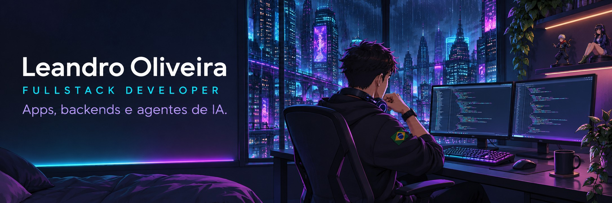

 

  

**Transformando ideias em apps, sistemas e agentes de IA.**

De Boa Vista, Roraima 🇧🇷 · Código, anime e vontade de construir.

 

## `01` / Sobre mim

Sou **Leandro Oliveira de Sousa**, desenvolvedor fullstack com foco em **Flutter, NestJS e inteligência artificial**. Construo aplicações que conectam interfaces, APIs e automações para resolver problemas reais.

No **Sábio.dev**, trabalho com gestão de projetos, integrações e agentes que usam os mesmos serviços das aplicações. Também participo de produtos como **Apex** e **VitaAI**, explorando gamificação e ferramentas de carreira com IA.

Fora do código, gosto de anime — e estou planejando o **Animesse**, um app para organizar os animes que já assistimos e os que queremos assistir.

> **Aprender, construir, publicar. Depois, evoluir.**

 

## `02` / Arsenal de desenvolvimento

 

 

| Área | O que utilizo |
| :--- | :--- |
| **Apps e interfaces** | Flutter · Dart · React · Next.js |
| **Backend** | NestJS · TypeScript · MongoDB · Redis · WebSockets |
| **Inteligência artificial** | Claude · OpenAI · Agentes com ferramentas |
| **Infra e integrações** | Firebase · Cloud Run · Docker · GitHub Actions · Slack · WhatsApp |

 

## `03` / Projetos em destaque

### 🧠 Sábio.dev
**Gestão de projetos com IA integrada ao trabalho da equipe.**

Projetos, sprints, backlog, Planning Poker e controle de tempo. O assistente **Sábis** conecta o Slack aos serviços do sistema para consultar informações, criar tarefas e gerar relatórios.

`NestJS` `Flutter` `MongoDB` `Redis` `Claude` `Slack`

---

### ⚡ Apex
**Gamificação para times de desenvolvimento.**

Pontos por atividades, integração com GitHub, ranking, conquistas, desafios e recompensas para acompanhar a evolução da equipe.

`NestJS` `Flutter` `MongoDB` `Firebase` `GitHub Webhooks`

---

### ✨ VitaAI
**Inteligência artificial para ajudar pessoas a apresentar sua trajetória profissional.**

Criação de currículos com IA, exportação em PDF e recursos voltados à jornada de quem busca uma oportunidade.

`Inteligência artificial` `Currículos` `PDF` `Firebase`

 

<a href="https://github.com/Sabe-o-dev">Conheça a organização Sábio.dev →</a>

 

## `04` / Próxima missão

**⛩️ Animesse — em planejamento**

Um lugar para lembrar de cada anime da sua jornada: encontrar títulos, organizar os já assistidos e montar a lista dos próximos.

 

---

**Vamos construir alguma coisa?**

  

Feito de código, café e mais um episódio. 🌃

